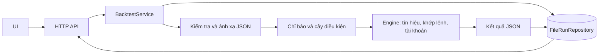
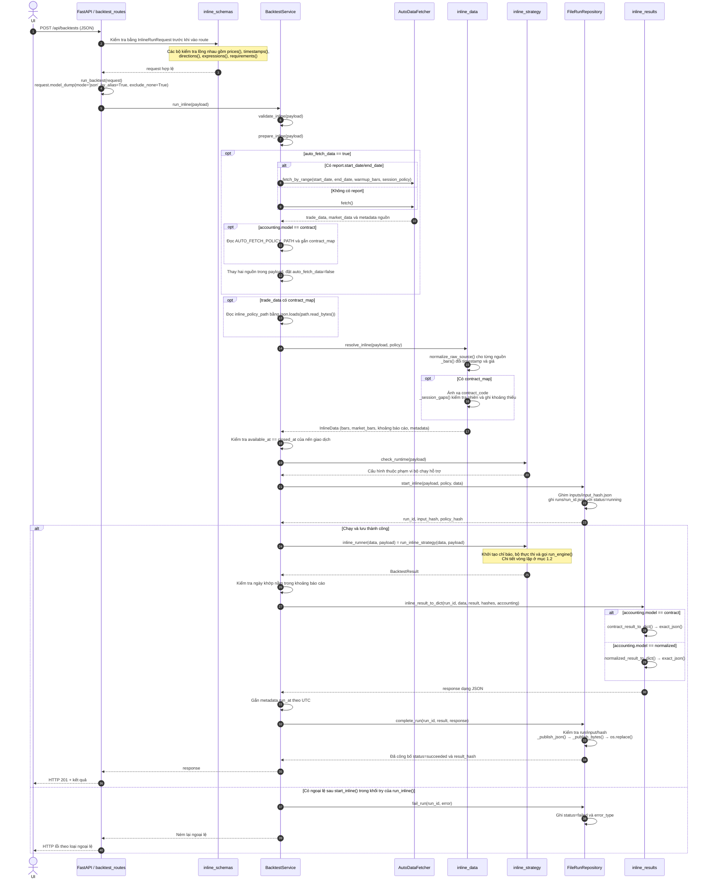
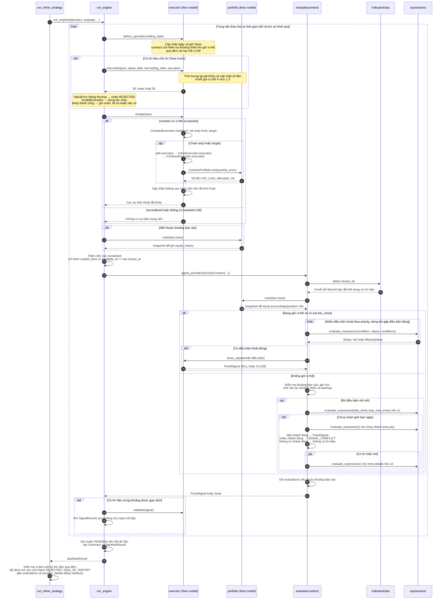
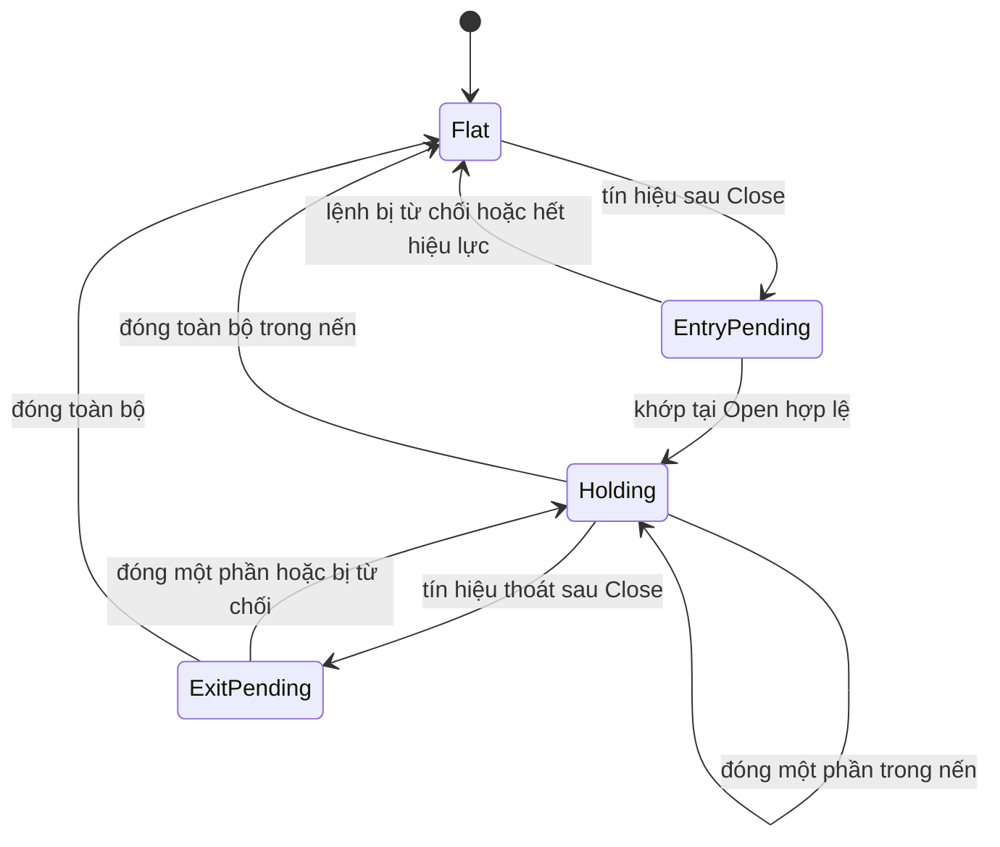

# Thiết kế hệ thống — Backtesting API

API hiện tại theo [hợp đồng khớp ngay hoặc LO, một vị thế và điểm](price-only-contract.md),
đã triển khai B–D. POST/validate chỉ nhận cấu hình, máy chủ luôn lấy dữ liệu; kết quả mới là schema 3.
[Kiểm chứng C–D](../testing/price-only-cd.md) ghi phạm vi đã kiểm tra. Lịch sử cũ vẫn đọc theo đơn vị gốc.

**Các mục bên dưới là tài liệu đường cũ để đối chiếu lịch sử**, không phải cấu trúc POST
đang được chấp nhận. Việc dọn đầy đủ tài liệu và mã cũ thuộc phần F.

## 1. Mục tiêu và luồng xử lý

Ứng dụng nhận JSON và xử lý theo các lớp:

`data → indicator → strategy evaluation → signal → execution → portfolio → metrics`

Web và notebook dùng cùng API. Quy tắc theo [hướng dẫn JSON](strategy-payload-guide.md), [CANSLIM v1](../strategies/canslim-v1-rules.md) và [tính tiền hợp đồng](canslim-v1-execution-accounting.md).



### 1.1. Một yêu cầu POST /api/backtests đi qua hàm nào?

- `strategy.entry`/`strategy.exit.bar_close`: ý định và loại lệnh.
- `execution.matching_model`: bộ khớp được chọn.
- `application/order_config.py`: đọc cấu hình cũ/mới.
- `domain/orders.py`: yêu cầu lệnh bất biến và kết quả lệnh.
- `domain/matching.py`: giá, lượng và thời điểm khớp.
- `engine.py`/`session_matching.py`: thời gian, lệnh chờ và vòng đời.
- `execution.py` và sổ tiền: áp dụng fill, bảo vệ, phí, ký quỹ và P/L.
- Thêm loại lệnh cần cập nhật schema, bộ khớp, biểu mẫu và kiểm thử.

- `MultiContractExecution` và `ContractBook` quản lý tài khoản chung, bảo vệ riêng từng `position_id`.
- `LotAccount` tái sử dụng bộ thực thi một vị thế; giá vốn và lượng đóng thuộc từng phần.
- Một vị thế và `next_open` giữ đường chạy hiện có. Hợp đồng cấu hình tại mục 3.4 đặc tả API.

- API chạy đồng bộ, chờ lưu kết quả xong mới trả `201`.
- Khi khởi động, `main.build_service()` nối `BacktestService`, `FileRunRepository` và `inline_runner=run_inline_strategy`.



- Schema sai: FastAPI trả `422` trước `run_backtest()`.
- Lỗi `validate_inline()`/`start_inline()` xảy ra trước khối chạy chiến lược nên nằm ngoài `fail_run()`.
- Route ánh xạ `ValueError` → `422`; `OSError`, `KeyError`, `TypeError` → `503`; `AutoFetchError` nguồn → `503`.
- Ngoại lệ khác theo xử lý mặc định. Ghi trạng thái failed phụ thuộc `fail_run()` hoàn tất.

`POST /api/backtests/validate`:

1. Route gọi `request.model_dump()` → `service.validate_inline(payload)`.
2. `InlineRunRequest.prefer_auto_data()` bỏ hai nguồn nhập tay khi `auto_fetch_data` là boolean `true`; vẫn kiểm tra nhóm cấu hình khác.
3. `prepare_inline()` chuẩn bị dữ liệu rồi trả kết quả kiểm tra.

Cách lấy dữ liệu:

- Có `report`: gọi `AutoDataFetcher.fetch_by_range()`, lùi số nến theo `warmup_bars`, chỉ báo và `shift`; giữ lịch sử cần dùng và nến đến hết `end_date`.
- Contract đếm nến liên tục; ATO cần ít nhất một nến trước kỳ. Khoảng thiếu giữ nguyên.
- Bỏ `report`: gọi `fetch()` lấy sáu tháng gần nhất. Hai nguồn dùng chung mốc Unix và chỉ giữ nến đã đóng, OHLCV hợp lệ.
- Contract dùng bảng đáo hạn hiện có và lịch `runtime-policy-v1.json`. Lịch sử giới hạn bởi ngày đầu lịch và đầu tháng đầu của bảng.
- Giới hạn ghi tại `metadata.auto_fetch.history_start_limit`; kỳ và `warmup_bars` giữ nguyên. Thiếu mẫu: chưa đánh giá được.
- Payload chuẩn bị có hai nguồn cụ thể, `auto_fetch_data: false`; metadata ghi nguồn, khoảng lấy, mã băm và số nến loại.
- Khi chạy, `start_inline()` lưu dữ liệu đã chuẩn bị để chạy lại.
- Lỗi HTTP/mạng trả `503`; dữ liệu nguồn sai trả `422`, trước khi tạo lượt chạy.
- `prepare_inline()` cũng thay cả hai nguồn cho lời gọi service trực tiếp. Lỗi tải kết thúc yêu cầu; đầu vào gốc của bên gọi giữ nguyên.

Endpoint kiểm tra chỉ chuẩn bị và xác thực đầu vào.

### 1.2. Trong mỗi nến, engine gọi gì và theo thứ tự nào?

`run_inline_strategy()` gọi lại `check_runtime(payload)`, dựng
`IndicatorData(data, payload)` và chọn bộ thực thi:

- `contract`: `InlineExecution` kế thừa `ContractExecution`, dùng `ContractPortfolio`.
- `normalized`: `InlineNormalizedExecution` kế thừa `NormalizedExecution`, dùng `Portfolio`.

- Sau đó hàm gọi `run_engine(..., signal_provider=evaluate, execution=lambda cash: executor, on_open=executor.before_open)`.
- `evaluate(context)` là hàm nằm bên trong `run_inline_strategy()`, không phải endpoint hay phương thức của engine.
- `run_engine()` kiểm tra thứ tự/thời gian nến và gọi hàm `execution` để nhận lại bộ thực thi đã dựng.



- `IndicatorData.__init__()` tính chuỗi theo từng đoạn dữ liệu.
- `at(stamp)` chỉ trả mẫu có `available_at <= stamp`, từ mốc khởi tạo lại sau chuyển mã hoặc khoảng thiếu.
- `evaluate_expression()` gọi `validate_expression()` trước khi tính; `all`/`any` đánh giá mọi toán hạng.

- Xét mở thiếu dữ liệu: ghi `UNEVALUABLE`, bỏ tạo tín hiệu.
- Xét thoát Close gặp `MissingValue`: bỏ nhãn đó, xét nhãn tiếp theo.
- Margin, time-stop và giờ thoát được xét qua biểu thức trong JSON.

### 1.3. Lời gọi khớp lệnh và vị trí source

| Bước                   | Chuỗi hàm thực tế                                                                                                                                                                                 | File                                                                                                                                                                                                                          |
| ------------------------ | ----------------------------------------------------------------------------------------------------------------------------------------------------------------------------------------------------- | ----------------------------------------------------------------------------------------------------------------------------------------------------------------------------------------------------------------------------- |
| Nhận HTTP               | `create_backtest_router()` đăng ký route `run_backtest(request)`                                                                                                                               | [backtest_routes.py](../../src/backtesting_api/api/backtest_routes.py)                                                                                                                                                         |
| Kiểm tra cấu trúc     | `InlineRunRequest` và các bộ kiểm tra của `DataInput`, `EntryInput`, `StrategyInput`                                                                                                     | [inline_schemas.py](../../src/backtesting_api/api/inline_schemas.py)                                                                                                                                                           |
| Điều phối             | `run_inline()` → `validate_inline()` → `prepare_inline()`                                                                                                                                     | [run_backtest.py](../../src/backtesting_api/application/run_backtest.py)                                                                                                                                                       |
| Dữ liệu                | `resolve_inline()` → `normalize_raw_source()`, `_bars()` và `_session_gaps()` khi có map                                                                                                   | [inline_data.py](../../src/backtesting_api/application/inline_data.py)                                                                                                                                                         |
| Chuẩn bị chiến lược | `run_inline_strategy()` → `check_runtime()`, `IndicatorData.__init__()`, khởi tạo executor → `run_engine()`                                                                               | [inline_strategy.py](../../src/backtesting_api/application/inline_strategy.py)                                                                                                                                                 |
| Vòng lặp               | `run_engine()` → `before_open()`, `execute()` nếu có pending, `intrabar()`, `mark()`, `evaluate()`, `validate()` nếu có tín hiệu                                                 | [engine.py](../../src/backtesting_api/domain/engine.py)                                                                                                                                                                        |
| Khớp theo phiên      | `run_engine()` → `run_session_engine()` → gửi ATO lúc 08:45, LO trong phiên, ATC lúc 14:30; `match_auction()` khớp tại 09:00/14:45 và làm phần dư hết hiệu lực | [engine.py](../../src/backtesting_api/domain/engine.py), [session_matching.py](../../src/backtesting_api/domain/session_matching.py) |
| Tính điều kiện       | `evaluate()` → `IndicatorData.at()` → `evaluate_expression()` → `validate_expression()`                                                                                                    | [inline_strategy.py](../../src/backtesting_api/application/inline_strategy.py), [expressions.py](../../src/backtesting_api/domain/expressions.py)                                                                               |
| Mua normalized           | `InlineNormalizedExecution.execute()` → `NormalizedExecution.execute()` → hàm `size(context)` → `Portfolio.buy()`                                                                         | [inline_strategy.py](../../src/backtesting_api/application/inline_strategy.py), [execution.py](../../src/backtesting_api/domain/execution.py), [portfolio.py](../../src/backtesting_api/domain/portfolio.py)                     |
| Bán normalized          | `InlineNormalizedExecution.execute()` → `NormalizedExecution.execute()` → `Portfolio.sell()`                                                                                                  | [execution.py](../../src/backtesting_api/domain/execution.py), [portfolio.py](../../src/backtesting_api/domain/portfolio.py)                                                                                                    |
| Mở contract             | `InlineExecution.execute()` kiểm tra thời gian, tính lượng và bracket → `ContractExecution.execute()` → `validate()` → `ContractPortfolio.enter()` → `ContractAccounting.costs()` | [inline_strategy.py](../../src/backtesting_api/application/inline_strategy.py), [execution.py](../../src/backtesting_api/domain/execution.py), [contract_accounting.py](../../src/backtesting_api/domain/contract_accounting.py) |
| Đóng contract          | `InlineExecution.execute()` → `ContractExecution.execute()` → `validate()` → `ContractPortfolio.exit()` → `ContractAccounting.costs()`                                                  | [execution.py](../../src/backtesting_api/domain/execution.py), [contract_accounting.py](../../src/backtesting_api/domain/contract_accounting.py)                                                                                |
| Chuyển kết quả        | `inline_result_to_dict()` → hàm theo model → `exact_json()`                                                                                                                                    | [inline_results.py](../../src/backtesting_api/application/inline_results.py)                                                                                                                                                   |
| Ghi đầu vào/kết quả | `start_inline()`, `complete_run()` hoặc `fail_run()` → `_publish_json()` / `_publish_bytes()`                                                                                             | [file_repository.py](../../src/backtesting_api/infrastructure/file_repository.py)                                                                                                                                              |

- Sổ tiền bất biến: `buy()`/`sell()` hoặc `enter()`/`exit()` trả bản mới; executor cập nhật `self.portfolio`, engine nhận lại sau fill.
- `mark()` trả ảnh chụp tài khoản.
- Bộ khớp mặc định tính lượng lúc `execute()`.
- HNX chốt LO theo giá giới hạn, ATO theo Close liên tục trước 08:45, ATC theo vị thế còn lại lúc 14:30.
- `auction_match_quantity` giới hạn lượng khớp, giữ nguyên lượng đặt.

## 2. Ranh giới module

| Thành phần        | Source                                                                                  | Trách nhiệm                                                       |
| ------------------- | --------------------------------------------------------------------------------------- | ------------------------------------------------------------------- |
| Điểm khởi chạy  | `backtesting_api/main.py`                                                             | Nối repository, bộ chạy JSON, chính sách và FastAPI           |
| HTTP                | `api/app.py`, `api/backtest_routes.py`, `api/inline_schemas.py`                   | Kiểm tra yêu cầu và ánh xạ lỗi HTTP                          |
| Điều phối        | `application/run_backtest.py`, `application/ports.py`                               | Kiểm tra, chạy, lưu và đọc qua một repository                |
| Dữ liệu           | `application/inline_data.py`, `infrastructure/market_snapshot.py`                   | Ánh xạ và kiểm tra OHLCV, thời gian, map hợp đồng           |
| Chiến lược JSON  | `application/inline_strategy.py`, `domain/expressions.py`, `domain/indicators.py` | Chỉ báo, biểu thức, điều kiện và trạng thái chiến lược |
| Thực thi và tiền | `domain/engine.py`, `execution.py`, `portfolio.py`, `contract_accounting.py`    | Điều phối thời gian, khớp lệnh và sổ tài khoản            |
| Kết quả           | `application/inline_results.py`, `domain/results.py`                                | Chuyển kết quả engine thành JSON                                |
| Kho file            | `infrastructure/file_repository.py`                                                   | Ghim đầu vào, lưu/đọc kết quả và dựng dữ liệu chart     |
| Giao diện          | `web/`                                                                                | Trình bày cùng một kết quả từ API                            |

Domain độc lập với API, application, infrastructure và web. JSON khai báo chỉ báo, biểu thức và hành động theo [cấu trúc repository](project-structure.md).

## 3. Thời gian, tín hiệu và trạng thái

- Engine xử lý các bước tại nến: thực thi lệnh chờ ở Open → áp dụng fill/rejection → xử lý thoát trong nến theo rule → ghi tài khoản tại Close → đánh giá điều kiện bằng dữ liệu đã khả dụng → tạo tín hiệu/lệnh chờ cho Open kế tiếp.
- Dữ liệu thị trường được ghép theo available_at, không theo chỉ số dòng.



- Signal, order và fill là record khác nhau.
- Không có fill thì không được tạo trade hoặc thay đổi vị thế như đã giao dịch.
- Sizing sử dụng giá/thông tin tại lúc thực thi, theo nhóm sizing/accounting trong JSON.
- Normalized và contract là hai mô hình tiền hiện hỗ trợ; các giới hạn cụ thể thuộc đặc tả API.

`IndicatorData` chỉ cung cấp mẫu đã khả dụng. Thiếu lịch sử hoặc dữ liệu bắt buộc tại `t`: ghi `UNEVALUABLE`, giữ nguyên khoảng thiếu và ranh giới hợp đồng.

## Các trường hợp lỗi và phục hồi theo luồng

Bảng này đặt lỗi tại đúng layer để không lẫn trách nhiệm giữa data, strategy,
execution, portfolio và repository. Mã `SDD-EX-*` là điểm nối cho state-machine
test và integration test.

| Case ID       | Điểm phát sinh                                                                | Ảnh hưởng trạng thái/dữ liệu                                                                                  | Hành động hệ thống                                                                                                         |
| ------------- | -------------------------------------------------------------------------------- | -------------------------------------------------------------------------------------------------------------------- | ------------------------------------------------------------------------------------------------------------------------------- |
| `SDD-EX-01` | Data loader/validator gặp schema, OHLC, thứ tự hoặc metadata sai             | Chưa được phép vào indicator/strategy; chưa có signal hoặc fill hợp lệ                                    | Dừng run và trả structured validation error; không tự sửa hoặc điền dữ liệu                                          |
| `SDD-EX-02` | Indicator/strategy thiếu warm-up hoặc required value tại`t`                 | Chỉ lần đánh giá hiện tại không có signal; state vị thế giữ nguyên                                      | Ghi reason unevaluable và tiếp tục các bar hợp lệ sau đó                                                                |
| `SDD-EX-03` | Lệnh chờ thiếu Open kế tiếp hợp lệ | Ghi trạng thái chờ hoặc cuối kỳ theo cấu hình | Kiểm tra trạng thái và nến thực thi theo hợp đồng kết quả |
| `SDD-EX-04` | Execution hoặc ledger từ chối order do quantity/cash/side/fee                 | Signal vẫn tồn tại; order rejected; position và ledger không đổi bởi fill                                    | Ghi order outcome/reason, chuyển sang bước mark/evaluate kế tiếp                                                           |
| `SDD-EX-05` | Vi phạm bất biến, như tiền hoặc vị thế âm ngoài sai số cho phép | Run thất bại | Trả lỗi có cấu trúc, chỉ công bố kết quả đầy đủ |
| `SDD-EX-06` | Lỗi ghi tệp hoặc sai hash/schema khi đọc | Từ chối công bố hoặc đọc dữ liệu lỗi | Kiểm tra thay tệp nguyên tử và tính toàn vẹn |
| `SDD-EX-07` | Evaluator có nguy cơ nhìn thấy dữ liệu sau decision hoặc full array       | Có nguy cơ làm sai signal, fill và tính tái lập                                                               | Chỉ truyền prefix/record có`available_at <= decision`; causality test phải chặn vi phạm                                 |
| `SDD-EX-08` | Service restart sau khi run đã thành công hoặc failed                       | Run thành công phải giữ được business result; run failed không xuất hiện trong history thành công        | Repository reload theo hash/schema; API chỉ đọc succeeded; trạng thái failed được lưu trong tệp run để đối chiếu |

## 4. Kho file và trạng thái lượt chạy

`BACKTEST_STORE_PATH` mặc định `data/backtest-store`:

```text
backtest-store/
├── inputs/<input_hash>.json       # JSON đầy đủ, chính sách và metadata dữ liệu
├── runs/<run_id>.json             # running / failed / succeeded và kết quả
├── datasets/                     # Dataset/Parquet đã ghim cho lịch sử phiên bản 1
└── policies/                     # Chính sách của lịch sử đã có
```

1. `start_inline()` ghim đầu vào/chính sách, tính `input_hash`/`policy_hash`, tạo run `running`.
2. Bộ chạy xử lý trong bộ nhớ.
3. `complete_run()` kiểm tra đầu vào và công bố toàn bộ kết quả `succeeded` bằng thay tệp nguyên tử, kèm `result_hash`.
4. Lỗi sau khi tạo run được ghi qua `fail_run()`.

Tính nguyên tử áp dụng từng tệp. Run thành công khi tệp kết quả đầy đủ đã được công bố.

Kết quả mới lưu thời điểm bắt đầu thực thi trong `metadata.run_at` theo UTC.
Lịch sử dùng trường này; run cũ dùng ngày tạo file JSON, hoặc ngày sửa cuối nếu
hệ thống không có ngày tạo. Không ghi lại kết quả cũ để bổ sung thời gian.

- `get_run()`: kiểm tra phiên bản, trạng thái, `run_id`, hash kết quả và đầu vào/chính sách phiên bản 2.
- `list_runs()`: chỉ trả `succeeded`, theo tên tệp giảm dần. UUID không biểu diễn thời gian tạo.
- `GET /api/backtests/history`: dùng `iter_run_summaries()` kiểm tra từng kết quả, lọc lợi nhuận/vốn cuối và trả trang tóm tắt.
- Web tải lịch sử khi được yêu cầu. Bộ lọc vẫn phải đọc từng tệp JSON được xét.
- `get_input()`: phục vụ phiên bản 2; phiên bản 1 trả lỗi tương thích vì thiếu input JSON.

- Chart phiên bản 2 dựng từ đầu vào đã ghim; không chạy lại chiến lược hoặc gọi nguồn ngoài.
- Trường open_time của một đầu vào lịch sử được ánh xạ khi đọc trên bản sao; JSON mới vẫn bắt buộc time.
- Chart phiên bản 1 đọc manifest và nến Parquet của lịch sử còn giữ; pyarrow phục vụ nhánh đọc này.

Kho có một tiến trình ghi. Đường dẫn chính sách/kho file tương đối được xác
định từ thư mục làm việc; chạy ứng dụng từ gốc repository theo
[hướng dẫn chạy](../guides/run-backtest.md).

## 5. Giao diện và đọc kết quả

- Mỗi run có một result; summary, chart, marker, giao dịch, vị thế, nhật ký và equity cùng `run_id`/hash.
- Frontend định dạng và lọc dữ liệu do API trả.
- Lỗi chart: thử lại GET theo `run_id` hiện có. Xem [đặc tả giao diện](web-ui-specification.md).

## 6. Kiểm thử

- Kiểm thử các lớp dữ liệu/biểu thức, trạng thái lệnh, tính tiền, lỗi ghi nguyên tử, hash/schema, đọc lịch sử, API, notebook và ánh xạ chart.
- Đối chiếu đầy đủ với dữ liệu cắt tại t và dữ liệu tương lai bị thay đổi; chạy cùng JSON nhiều lần phải giữ kết quả nghiệp vụ sau khi tách UUID và metadata.run_at.
- Input/policy hash được đối chiếu khi cùng đầu vào đã ghim; result_hash bao gồm định danh và thời điểm chạy nên có thể khác giữa hai run.

Các test hiện có và giới hạn kiểm chứng tại
[danh mục kiểm thử](../testing/vn30f1m/canslim-v1-test-cases.md).
