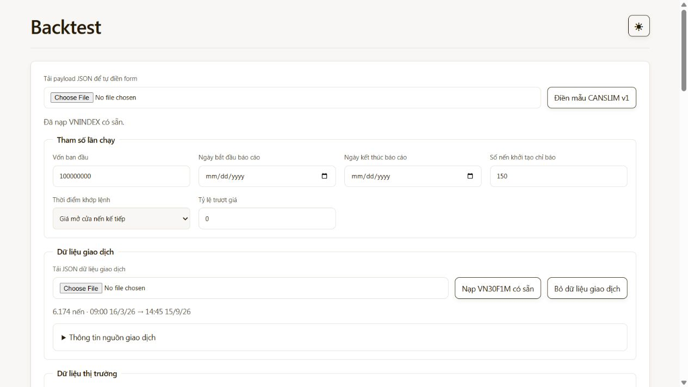
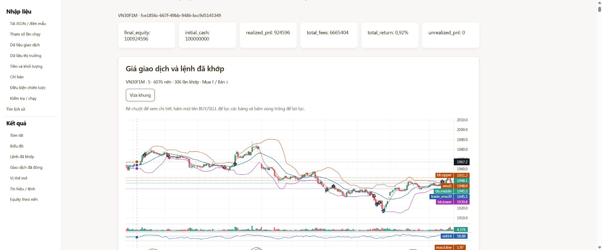

# Đặc tả giao diện — Backtesting API

## Tra cứu tham số

Nút **Tra cứu tham số** cạnh vùng JSON hoặc trong mục lục mở cửa sổ hai cột:
nhóm Cấu hình / Chỉ báo / Toán tử, ô tìm kiếm trong nhóm, danh sách chọn bên trái
và chi tiết/ví dụ bên phải. Màn hình nhỏ xếp danh sách phía trên chi tiết.
Chỉ tải danh mục từ API khi mở lần đầu; đổi nhóm/tìm/chọn không gọi lại API.
Lỗi tải có thông báo và có thể thử lại khi mở. Nội dung hiển thị bằng văn bản,
không diễn giải HTML, không sửa cấu hình hoặc tự chạy. Ví dụ cấu hình được bọc
theo đường dẫn trường; alias/toán tử giữ ví dụ gốc. Bỏ thông tin rỗng và số mẫu 0.
Cửa sổ dùng dialog gốc: giới hạn focus bên trong, Escape/Đóng đóng cửa sổ và trả
focus về nút mở; khi mở, focus vào ô tìm kiếm. Mã và JSON giữ nguyên khi đổi ngôn ngữ.

## Thu gọn bảng kết quả

Mỗi bảng lệnh đã khớp, giao dịch đã đóng, vị thế đang mở, tín hiệu, lệnh và
lãi/lỗ theo nến có nút **Rút gọn / Mở rộng** riêng cạnh tiêu đề. Mặc định mở bảng;
thu gọn chỉ ẩn nội dung, giữ nguyên dữ liệu và trạng thái các bảng khác.
Nút dùng được bằng bàn phím, công bố `aria-controls` và `aria-expanded`.
Thao tác không gọi lại API hoặc chạy lại backtest; áp dụng cả kết quả mới và lịch sử cũ.

## 1. Phạm vi hiện tại

- Trang `/`: nhập tham số, điền mẫu hoặc tải payload JSON, kiểm tra và chạy.
- Điều kiện chiến lược dùng ô JSON riêng với dữ liệu giá.
- Kết quả: tổng quan, nến, khối lượng, chỉ báo, marker, equity và bảng đối chiếu.
- Lịch sử mở lại kết quả đã lưu. Web và notebook dùng cùng API; mọi dữ liệu hiển thị thuộc cùng run.

## 2. Luồng người dùng

1. Điền mẫu CANSLIM v1 hoặc tải payload JSON. Mẫu có 2 nến mỗi nguồn; dữ liệu đã nạp được giữ khi điền mẫu.
2. Kiểm tra qua `POST /api/backtests/validate`.
3. Chạy qua `POST /api/backtests`; khóa nút gửi trong khi chờ.
4. Hiển thị kết quả và tải chart theo `metadata.run_id`.
5. Bấm **Tìm lịch sử** để tải trang tóm tắt; chọn dòng hoặc **Xem** để đọc kết quả/chart bằng GET.

**Lọc và xem lịch sử**

- Khi mở trang, biểu mẫu và bộ lọc ở trạng thái chờ nhập.
- Bộ lọc lợi nhuận (%) và vốn cuối (`final_equity`) là tùy chọn, kết hợp AND, gồm hai đầu khoảng.
- Vốn giữ đơn vị của từng lượt chạy.
- Mỗi trang có 20 dòng: symbol, ngày đầu/cuối, lợi nhuận, vốn cuối và thời điểm chạy đến giây theo UTC+7.
- UUID hiện khi rê chuột; vốn cuối chỉ hiển thị số.
- Trang tiếp giữ bộ lọc; **Tìm lịch sử** quay về trang đầu. Nút **Xem** hỗ trợ bàn phím.
- `STRUCTURE_VALID` xác nhận đầu vào; độ đủ lịch sử được đánh giá khi chạy.

### Vùng nhập cấu hình và dữ liệu

Ảnh minh họa phần đầu của form sau khi điền mẫu và nạp hai nguồn có sẵn:

- Form có vốn ban đầu, ngày bắt đầu/kết thúc báo cáo, số nến khởi tạo chỉ báo,
  thời điểm khớp lệnh và trượt giá. Hai ngày báo cáo cùng bỏ trống hoặc cùng có giá trị.

**Tự lấy dữ liệu**

- **Lấy dữ liệu tự động** mặc định tắt, tương ứng `auto_fetch_data=false`.
- Bật: khóa hai vùng dữ liệu, giữ nội dung đã nhập. Tắt: mở lại hai vùng.
- Nạp payload có cờ `true`: tự bật. Điền mẫu: giữ lựa chọn hiện tại.
- Bật tự lấy rồi bấm **Kiểm tra payload** hoặc **Chạy backtest**: gửi `auto_fetch_data=true`, bỏ hai nguồn nhập tay khỏi request.
- API tải VN30F1M/VNINDEX từ VNDIRECT khi gửi yêu cầu. Lỗi nguồn kết thúc yêu cầu.
- Có `report`: lấy lịch sử khởi tạo cần dùng trước ngày bắt đầu, tải đến hết ngày kết thúc.
- Bỏ `report`: lấy sáu tháng gần nhất. Các cấu hình khác vẫn được kiểm tra theo [quy tắc API](backtest-api-specification.md).

**Chiến lược và lệnh**

- Chọn mô hình normalized/contract và cách tính khối lượng để hiện các tham số
  tương ứng. Khi đổi mô hình hoặc loại chỉ báo, nhập các tham số của lựa chọn mới;
  giao diện không tự đổi điều kiện BUY/LONG/SHORT hoặc ngưỡng chiến lược.
- Chỉ báo có tên, loại, nguồn và tham số; có thể thêm/xóa. Điều kiện `entry`,
  `exit`, `daily_limits` và bảng đáo hạn `contract_map` giữ các ô JSON riêng,
  mỗi ô tối đa 65.536 ký tự. Đây là giới hạn trình soạn trên web, không đổi giới hạn API.
- **Mô hình khớp lệnh** chọn `next_open` hoặc HNX.
- Mỗi nhánh mở/đóng có ô loại lệnh, giá LO và thời hạn. Biểu mẫu và JSON cập nhật hai chiều.
- Đổi loại giữ giá/thời hạn cũ; cấu hình xung đột cần sửa trước khi gửi.
- JSON cũ giữ cấu trúc đến lần chỉnh lệnh đầu tiên; sau đó chuyển hai nhóm sang `actions`, giữ thời hạn kế thừa.
- `pyramiding` chọn nhiều lần mở theo ràng buộc API.
- HNX hỗ trợ MTL/MOK/MAK với **Lượng đối ứng cố định mỗi nến** và `price_limits` trong nguồn giao dịch.
- MTL có thời hạn cho LO dư; MAK/MOK kết thúc sau lần thử đầu.
- Thiếu biên giá hoặc chọn normalized/`next_open`: báo lỗi.
- Thay nguồn giao dịch: bảng biên giá theo tệp mới.
- Lịch sử của chế độ lượng cố định hiển thị loại ban đầu/có hiệu lực,
  giá LO chuyển đổi, lượng mong muốn/nhận đặt/khớp/hủy/từ chối/hết hạn.
  Chọn fill mở thứ hai trở đi vẫn nối tới cùng vị thế và các lần đóng.
  Bản dịch thuộc `language.mjs`; khóa JSON và giá trị kỹ thuật giữ nguyên.

**Nạp dữ liệu**

- Tải payload đầy đủ sẽ thay cấu hình và dữ liệu trên form. Tải JSON vào từng nguồn
  chỉ thay nguồn đó, giữ cấu hình và nguồn còn lại. Dữ liệu nhận dạng danh sách nến,
  object `bars`, OHLCV dạng `t/o/h/l/c/v` hoặc phần tương ứng trong payload đầy đủ.
- Nạp VN30F1M: `data/trade/vn30f1m-5m-20260316-20260915.json` → `trade_data`.
- Nạp VNINDEX: `data/market/VNINDEX_5&from=1772323200&to=1789516800.json` → `market_data`.
- Endpoint cố định: `GET /ui-data/trade_data`, `GET /ui-data/market_data`.
- Tệp nằm dưới `data` của thư mục chạy; Compose đã gắn thư mục này. Thiếu tệp: báo lỗi và cho tải JSON lên.
- Nến nằm trong dữ liệu của form; chỉ hiện số nến và thời gian đầu/cuối, không
  tạo trường nhập cho từng nến và không đưa toàn bộ payload vào textarea.
  Bỏ một nguồn sẽ bỏ dữ liệu và thông tin của nguồn đó.

**Gửi yêu cầu**

- Kiểm tra/Chạy ghép lại JSON theo hợp đồng hiện tại. Vốn, tỷ lệ phí và tham số
  thập phân được giữ dạng chuỗi khi chỉnh, tránh làm tròn qua số JavaScript.
  Giá trị và kiểu của trường chưa chỉnh được giữ nguyên khi tải payload lên.
  Không gửi file/multipart hoặc đường dẫn file đến API backtest.
- Trong khi đọc JSON, các nút nạp tạm khóa và Chạy không gửi dữ liệu chưa nạp xong.
  JSON sai không thay cấu hình đang có. Các lỗi kiểm tra chiến lược/dữ liệu vẫn
  do API hiện tại xác định; giao diện không sửa, sắp xếp hoặc tự điền nến thiếu.

## 3. Mapping dữ liệu

| Thành phần | Nguồn | Quy tắc |
| --- | --- | --- |
| Summary | `summary` | Chỉ định dạng số/return |
| Lịch sử | `GET /api/backtests/history` | Lọc tại máy chủ, chỉ nhận tóm tắt theo trang; giữ thứ tự repository |
| Nến và volume | `GET /api/backtests/{run_id}/chart` | Đúng nguồn, kỳ báo cáo, resolution và timezone |
| Chỉ báo | `evaluations` và dữ liệu market của run | Dùng giá trị máy chủ; chỉ hiển thị khi có |
| Marker | `fills` | Giá khớp thật; không dùng signal làm giao dịch |
| Giao dịch đóng | `trades` | Hiển thị quantity, phí và lãi/lỗ đã chốt |
| Vị thế mở | `open_positions` khi có, nếu không dùng `open_position` | Hiển thị từng phần và lãi/lỗ chưa chốt riêng, liên kết bằng position_id |
| Audit | `signals`, `orders` | Giữ trạng thái rejected/pending/filled riêng |
| Equity | `equity_history` | Điểm tại Close, trục riêng với giá nến |

Normalized dùng BUY/SELL; contract dùng LONG/SHORT/CLOSE và thông tin hướng,
mã hợp đồng, phí/thuế/ký quỹ khi có. Không diễn giải normalized quantity thành
số hợp đồng. Các run lịch sử được trình bày theo metadata đã lưu.

## 4. Chart và chọn giao dịch

- Kiểm tra run_id và hash/dataset phù hợp trước khi vẽ; không trộn run cũ/mới.
- Marker neo đúng fill_price; nến chứa fill theo bar_time khi có. Không ép giá
  khớp về High/Low nếu trượt giá đưa fill ra ngoài nến.
- Tooltip lấy reason theo fill.order_id → order.signal_id → signal.reason.
- Chọn marker lọc fills cùng ngày, trade chứa fill, signal/order liên quan,
  vị thế mở từ fill và equity tương ứng. Chọn vùng trống để bỏ lọc.
- Giữ bảng fills để đối chiếu. Rejected/unfilled không có marker.
- Volume và chỉ báo volume không dùng trục giá nến; equity có chart riêng.
- Zoom/scroll/resize không làm marker lệch giá/thời gian; dọn chart/listener khi đổi run.
- Thiếu nến hoặc sai OHLC/hash báo lỗi, không tự điền nến, sort hoặc dời marker.
- Nút thu gọn/mở rộng equity chỉ thay cách trình bày, không sửa dữ liệu.

### Mục lục toàn trang

- Từ 1200 px: thanh điều hướng ghim góc trái trên, cao bằng màn hình.
- Nội dung tối đa 1200 px, căn giữa. Dưới 1600 px, chừa lề cân hai bên để tránh thanh điều hướng che nội dung.
- Tiêu đề Nhập liệu/Kết quả: đậm 18 px, đen khi sáng, trắng khi tối. Liên kết con thụt 12 px.
- Luôn có liên kết đến tải JSON/điền mẫu, tham số lần chạy, dữ liệu giao dịch,
  dữ liệu thị trường, tiền và khối lượng, chỉ báo, điều kiện chiến lược,
  kiểm tra/chạy và tìm lịch sử.
- Chỉ thêm nhóm Kết quả khi có run đang hiển thị: tóm tắt, biểu đồ, lệnh đã khớp,
  giao dịch đã đóng, vị thế mở, tín hiệu/lệnh và equity theo nến.
  Đang tải hoặc tải run lỗi thì ẩn nhóm này; lỗi chart vẫn giữ mục lục kết quả
  nếu dữ liệu bảng đã tải.
- Khi cửa sổ dưới 1200 px, dùng nút Mục lục ghim ở góc dưới bên trái. Nút mở thanh
  dọc phủ tạm lên trang; chọn một mục thì đóng lại và nhảy đến vùng tương ứng.
  Có thể dùng Tab và Enter để điều hướng. Mục lục dài cuộn riêng theo chiều dọc.
- Bảng cuộn theo trang; các liên kết đưa về tiêu đề/nút thu gọn.
  Mục lục không thay đổi lượng dữ liệu tải từ API.

## 5. Trạng thái và lỗi

Hiển thị riêng các trạng thái: ban đầu, đang tải, có giao dịch, trống giao dịch, còn vị thế và lỗi. `evaluation_status` cho biết mức đủ dữ liệu để đánh giá.

- Sequence loại phản hồi đến muộn.
- POST thành công nhưng GET chart lỗi: giữ kết quả/bảng, cho thử lại GET.
- Lỗi lịch sử hiển thị riêng; lỗi result ẩn kết quả/chart cũ.
- Thông báo API hiển thị dạng văn bản thuần.

## 6. Tài nguyên và giao diện đã chọn

HTML/CSS/JavaScript ES modules đóng gói trong `backtesting_api/web`, được
FastAPI phục vụ cùng origin tại `/static`. Module .mjs dùng MIME text/javascript.
Lightweight Charts và LICENSE/NOTICE được lưu trong `web/vendor`.

- Màu theo [DESIGN.md](DESIGN.md): nền kem, chữ nâu đậm, nút vàng hổ phách.
- Ứng dụng dùng `create_app(..., preview=True)`, `preview.css` và `preview-theme.mjs`.
- Nút sáng/tối có nhãn truy cập; lựa chọn lưu ở `backtest-preview-theme`, đồng bộ tab qua `themechange`.
- Màu nến và hướng giao dịch giữ ý nghĩa đã chọn. Font lấy từ tài nguyên máy.

- Liên kết **VN / ENG** nằm cùng hàng với nút sáng/tối ở đầu trang.
- Nhóm ngôn ngữ có nhãn cho trình đọc màn hình.
- Ngôn ngữ được chọn có chữ đậm, gạch chân và `aria-current`.

- Mặc định tiếng Việt; lưu `en`/`vi` ở localStorage `backtest-language`, khôi phục khi tải trang.
- `web/language.mjs` dịch nhãn, hướng dẫn và thông báo, gồm nội dung cập nhật từ kết quả/lịch sử; cập nhật `lang` của trang.
- Đổi ngôn ngữ giữ nguyên lượt chạy, dữ liệu nhập, JSON, mã lỗi và dữ liệu bảng.
- Nội dung thiếu bản dịch giữ nguyên; chart thư viện và JSON thô dùng nội dung gốc.

## 7. Nghiệm thu

- Form/validate/run/history dùng đúng hợp đồng JSON và endpoint còn hoạt động.
- Các payload mẫu điền và ghép lại không đổi nội dung; chỉnh tham số không đổi
  nến hoặc nguồn còn lại. Hai nguồn có sẵn trùng đúng nội dung file được chỉ định.
- Số trường và tổng chữ trong textarea không tăng theo số nến. Kiểm tra nhập,
  cuộn và Chạy hai lần liên tiếp; RAM giảm không tự chứng minh hết mọi nguyên nhân lag.
- Chart, summary và bảng khớp cùng run/hash; marker đúng số fill và giá/thời gian.
- No-fill, rejected, vị thế mở và lỗi chart được trình bày đúng trạng thái.
- Không tạo POST mới khi thử đọc lại chart; response cũ không thay run đang chọn.
- Tài nguyên đóng gói tải được sau cài đặt/Docker, có attribution của thư viện.
- VN / ENG nằm sát nút sáng/tối; chọn bằng chuột hoặc bàn phím, nhận biết
  ngôn ngữ đang chọn và khôi phục lựa chọn sau khi tải lại trang. Kiểm tra
  chuyển hai chiều khi đang nhập form hoặc xem run/lịch sử: nhãn/thông báo
  đổi ngôn ngữ nhưng giá trị nhập và dữ liệu kết quả giữ nguyên.
- Mở run sau restart vẫn đọc cùng result; keyboard, label, focus, aria-live và
  bố cục mobile là các mục kiểm tra giao diện.

Các test hiện có và giới hạn bằng chứng tại
[danh mục kiểm thử](../testing/vn30f1m/canslim-v1-test-cases.md).
